# Rooftop functions: the seven-colour system

```{admonition} Learning objectives
:class: tip
After reading this page, you will be able to:
- Name the seven rooftop colours and the functions each one covers.
- Explain what a "golden combination" is and give examples.
- Describe the principles for applying the colour system in your city.
```

## Origin

MultiRoofs classifies rooftop functions with a seven-colour system developed for the City of Rotterdam in the *Concept Omgevingsprogramma Multifunctionele Daken* (2022, by P2, Plaattaal and Superworld). Each colour stands for one type of rooftop use. Together, the colours give planners, owners and residents a shared language to describe rooftop uses and combine them into multifunctional roofscapes.

```{figure} ./images/multiroofs_coloring.png
:alt: Coloring scheme of rooftop usage
:width: 90%
:align: center
:name: fig-multiroofs_coloring

Coloring scheme of rooftop usage. Adapted from [*Concept Omgevingsprogramma Multifunctionele Daken*](https://indd.adobe.com/view/acce48c3-9876-406c-bc22-2b23f85429ea)
```

## The seven colours


| Colour | Main function | What it includes | Key benefits | Example |
|---|---|---|---|---|
| **Green** | Nature and biodiversity | Gardens, roof parks, urban agriculture, biodiversity corridors and habitats | Reduces urban heat, supports biodiversity, improves air quality, creates accessible green space, supports mental health and well-being | 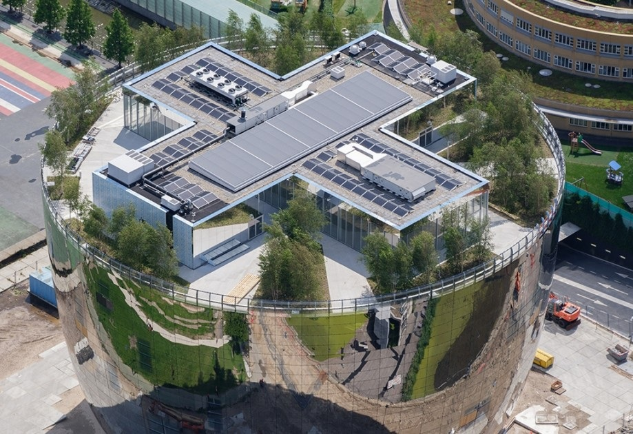<br>Depot Boijmans Van Beuningen, Rotterdam |
| **Blue** | Water retention and management | Rainwater storage and stormwater management | Reduces flood risk, relieves the sewer system, supports vegetation and cooling through evaporation, saves water | 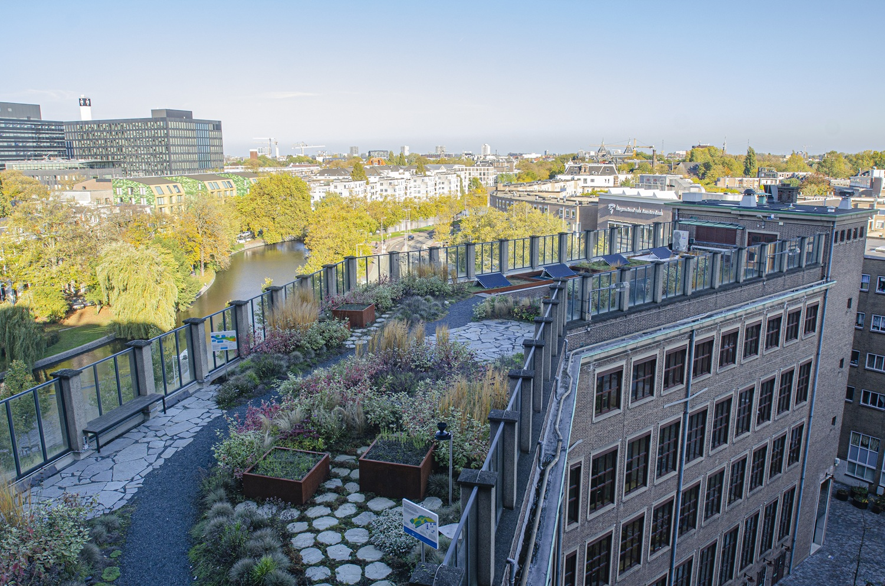<br>[Resilio project](https://resilio.amsterdam/en/), Amsterdam |
| **Yellow** | Energy transition | Energy generation, storage and insulation; cooling and shading | Produces renewable energy, reduces greenhouse gas emissions, saves energy, increases resilience, reduces urban heat (e.g., reflective coatings) | 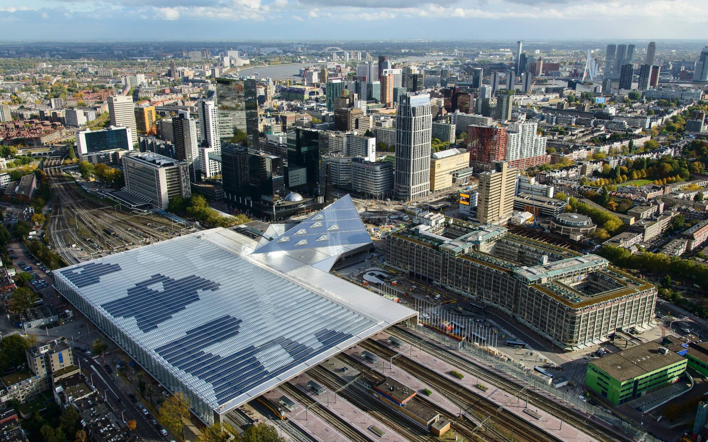<br>Rotterdam Central Station (solar panels integrated in the glass roof) |
| **Red** | Social and community | Playgrounds, sports facilities, schoolyards, cultural venues (theatre, cinema), bars and restaurants, shared equipment | Supports community inclusion, health and equity | 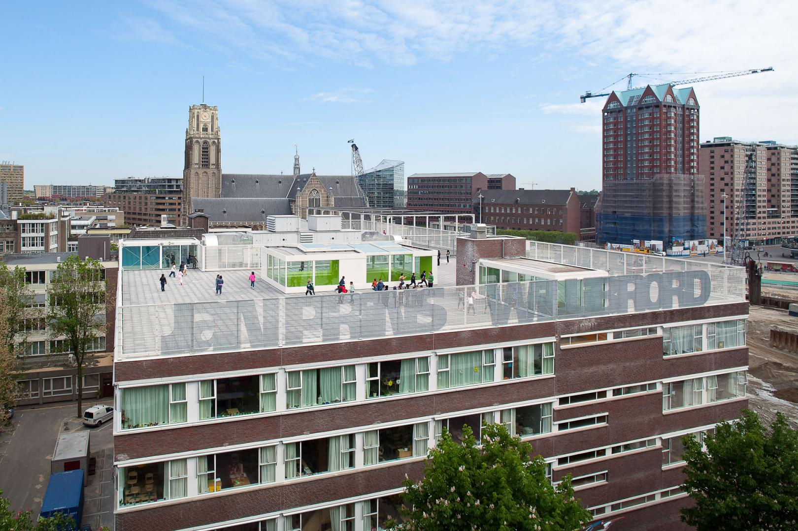<br>Roof playground of the Jan Prins School, Rotterdam |
| **Orange** | Mobility | Pedestrian and cycling connections, last-mile logistics hubs, intermodal connections, emergency routes, urban tourism | Improves connectivity, sustainable mobility and emergency readiness | 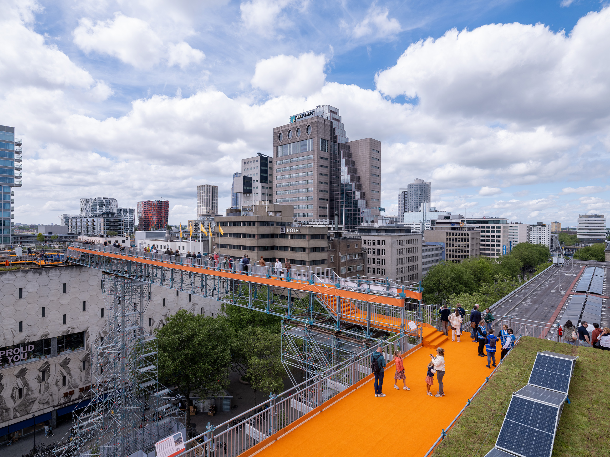<br>[Rotterdam Rooftop Walk](https://rooftopwalk.nl) (2022) |
| **Purple** | Densification | Habitable and usable spaces, such as housing, workspaces and facilities | Supports densification, housing supply, economic activity and mixed-use vitality | 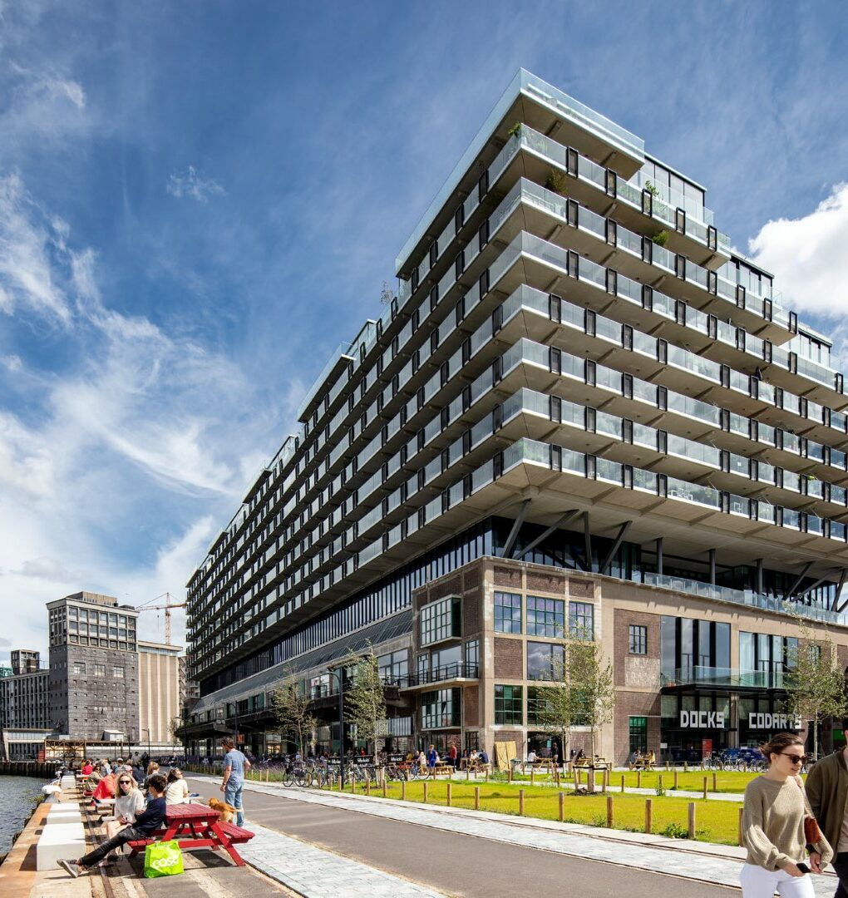<br>[Fenix I](https://mei-arch.eu/en/projects/fenix-1/), Rotterdam |
| **Grey** | Utilities and infrastructure | HVAC, telecom equipment, ventilation, antennas, safety guardrails, maintenance rails | Keeps the building running and supports the other functions | 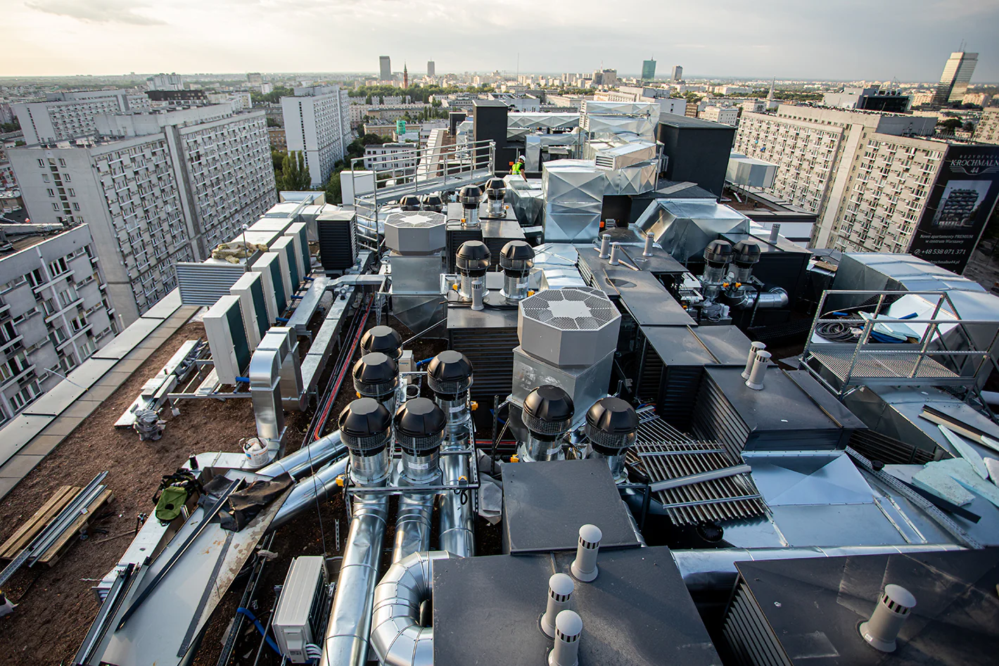<br>16-storey residential building on Grzybowska Street in Warsaw, Poland |

## Golden combinations

A rooftop delivers more value when several functions are combined. When functions reinforce each other, MultiRoofs calls the result a **golden combination**.

For example, vegetation on a green roof cools the roof through shade and evaporation. This benefits the local microclimate and also makes solar panels on a yellow roof more efficient, since they perform better at lower temperatures. Adding water retention (blue) reduces flood risk, keeps plants alive and further cools the roof. Green, blue and yellow therefore strengthen each other's effect.

```{figure} ./images/golden-rooftops.jpg
:alt: Golden rooftops
:width: 80%
:align: center
:name: fig-golden-rooftop

Example of a golden rooftop where solar energy generation, vegetation and water retention systems are combined. Picture taken from the [Dutch housing project Mannoury](https://www.dutchwatersector.com/news/blue-green-roofs-to-increase-energy-yield-of-solar-panels)
```

Combinations identified by the MultiRoofs partner cities include:

| Combination | Shared benefit | Example |
|---|---|---|
| Green + Blue | Water retention and cooling | 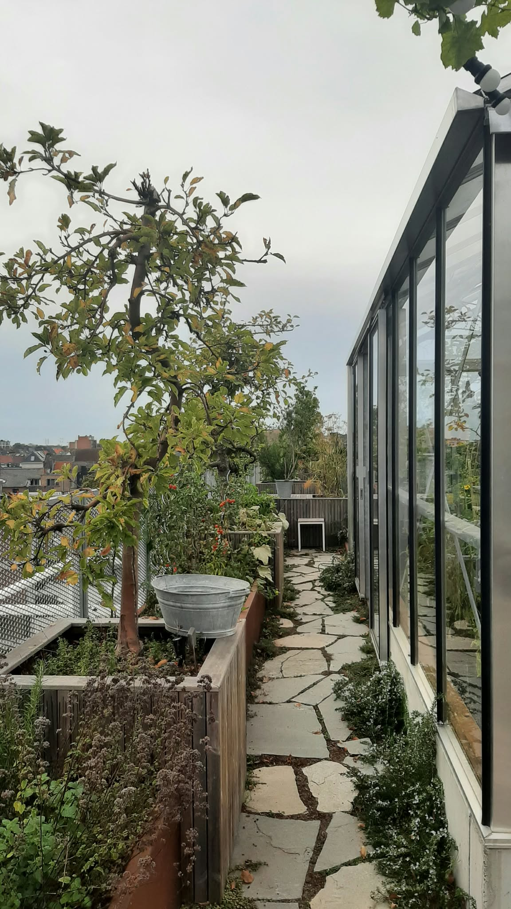<br>Hof van Evert daktuin, Mechelen |
| Green + Yellow | Higher energy efficiency | 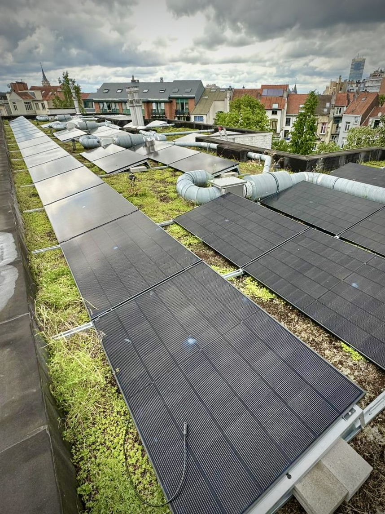<br>Community solar project in Saint-Gilles, Brussels |
| Green + Red | Urban farming and social use | 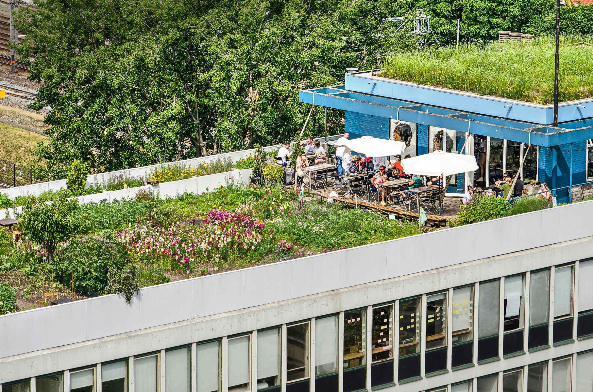<br>DakAkker rooftop farm and garden located on top of the Schieblock building, Rotterdam |
| Yellow + Purple | Sustainable housing | 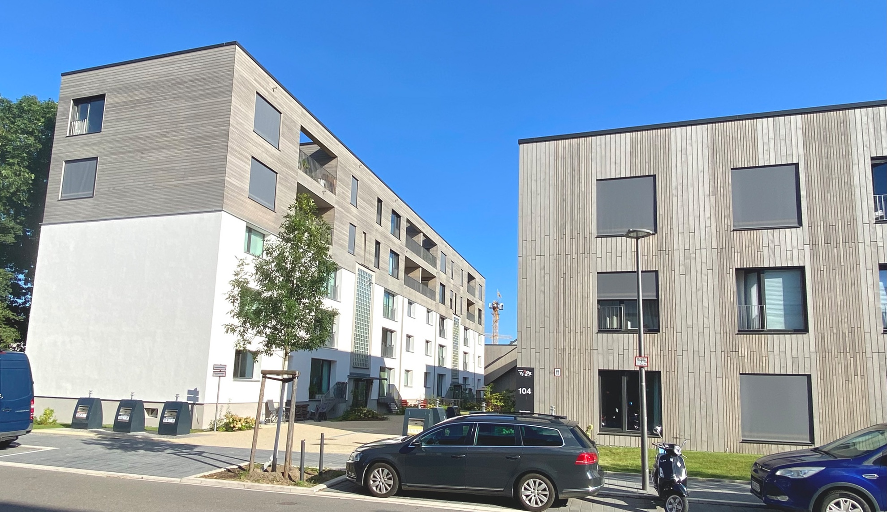<br>[Franklin Village](https://www.sauerbruchhutton.de/de/project/bfm) (building H6), Mannheim  |

## Principles for applying the colours

**Two levels of detail.** The seven colours are the public-facing level, used to communicate options simply to owners, residents and decision-makers. A professional
level adds subcategories, quality criteria and design guidance, so that planners and engineers can adapt solutions to specific buildings.

**Local tailoring.** The colours are the same in every city, but their application is not. Climate, policy, building structures and community priorities differ, so
cities adjust intensity, accessibility and design requirements while keeping the shared classification.

**Time-sharing.** Limited rooftop space can serve different uses at different times. A school roof, for instance, can serve pupils during the day and the wider community
in the evening.

**Priority zones.** Cities can focus their efforts on areas where the need is greatest, for example districts with heat stress, flooding, or a lack of green space
or social facilities.

**Timing with other projects.** Rooftop upgrades are cheaper, faster and more effective when combined with planned maintenance, renovation or district-level
projects.

```{admonition} Key takeaways
:class: important
- Seven colours describe what a roof can be used for: green, blue, yellow, red, orange, purple and grey.
- A single roof can have several colours at once.
- Combining functions that reinforce each other creates golden combinations with greater value than each function alone.
- The classification is shared across cities, but its application is adapted locally.
```