This section provides step-by-step tutorials to help users understand how to work with the [MRIO website](https://multiroofs.github.io/mrio/).


# MRIO Tutorial

<div style="text-align: justify;">

## 1. Introduction: What is MRIO?

[MRIO](https://multiroofs.github.io/mrio/) (MultiRoofs input/output) is a web tool for preparing, checking, and editing 3D building data. It is part of the MultiRoofs workflow. Instead of opening a complex JSON file and editing it by hand, you can use buttons and simple dialogs to manage building information.
 Figure 1 below illustrates the MRIO welcome page.

<div style="text-align: center;">
  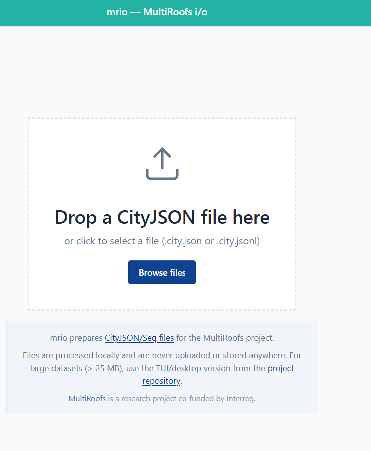
  <p><em>Figure 1: The MRIO welcome page. Use Browse files or drag and drop a supported model.</em></p>
</div>

## 2. Upload your file

1. Open the [MRIO website](https://multiroofs.github.io/mrio/).

2. Click Browse files and select a .city.json or .city.jsonl file, or drag it onto the upload area. As shown in Figure 2 below

<div style="text-align: center;">
  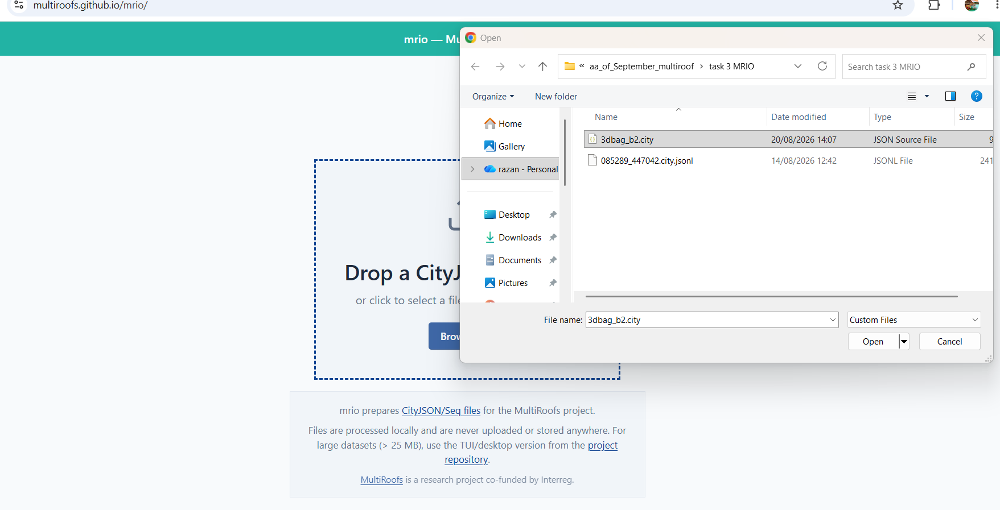
  <p><em>Figure 2: Upload the cityjson or cityjsonl file.</em></p>
</div>

3. Wait for the File Overview to appear. Check that the format, number of objects, vertices, and CRS are shown. Note: If you notice that the data in the File Overview and Attributes sections of your website differ from what is shown in the screenshot, it is because you uploaded a different type of file containing different data.
<div style="text-align: center;">
  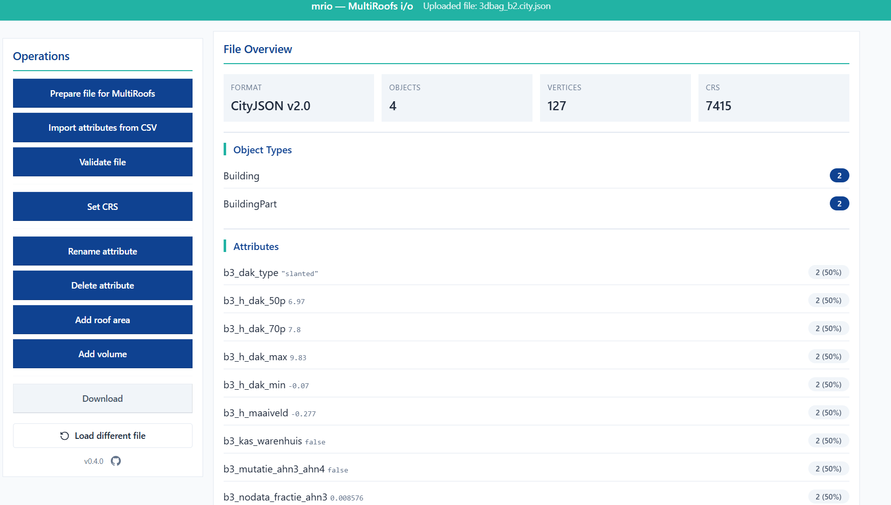
  <p><em>Figure 3. File Overview after uploading.</em></p>
</div>

## 3. Understanding the main workspace

After uploading a CityJSON or CityJSONSeq file, MRIO displays the main interface as shown in Figure 4 below, which is divided into two sections: the Operations panel on the left,  the File Overview panel in the center and the Attributes section.

<div style="text-align: center;">
  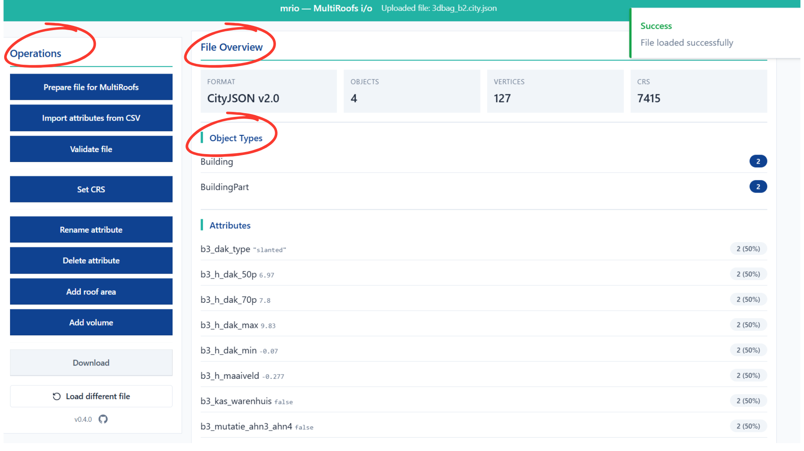
  <p><em>Figure 4 The main workspace.</em></p>
</div>

The <span style="color: #D32F2F; font-weight: 600;">Operations panel</span> , located on the left side of the interface, provides the tools needed to process and modify the uploaded file. Users can calculate roof surface areas and building volumes, delete or rename existing attributes, convert Roofer output into the MultiRoofs format, import additional attributes from CSV files, update the Coordinate Reference System (CRS),  and validate the dataset. The panel also includes a Download button to save the processed file and a Load different file button to upload another dataset.

The <span style="color: #D32F2F; font-weight: 600;">File Overview panel</span> , displayed in the main area of the interface, provides a summary of the uploaded dataset. At the top, four information boxes show the file format, total number of City Objects, number of vertices, and Coordinate Reference System (CRS). In the example shown in the figure, the uploaded file is in CityJSON version 2.0 format and contains 4 CityObjects, 127 vertices, and a CRS identified by EPSG code 7415. FORMAT tells you whether the model is CityJSON or CityJSONSeq. OBJECTS is the number of CityObjects (not necessarily the number of buildings). VERTICES are the coordinate points used to describe geometry. CRS is the coordinate reference system code, such as EPSG:28992.
Below these boxes, the Object Types section displays the different types of objects contained in the dataset and their quantities. In this example, the file contains 2 Building objects and 2 BuildingPart objects. Buildings represent the main building entities, while BuildingParts represent individual parts of buildings that may contain their 3D geometry. Object Types separates Building and BuildingPart. A BuildingPart can hold the 3D roof/wall geometry while its parent Building holds descriptive information. Attributes are pieces of information attached to objects—for example construction year, roof type, or volume.

The <span style="color: #D32F2F; font-weight: 600;">The Attributes section</span>, located below Object Types, lists the available attributes associated with the CityObjects. These attributes describe building characteristics such as roof type, roof height, ground elevation, and other properties. Each row displays the attribute name, an example value, and the number and percentage of CityObjects containing that attribute. For example, the attribute b3_dak_type has the displayed value slanted, while 2 (50%) indicates that 2 out of the 4 CityObjects contain this attribute. The displayed value is an example and does not necessarily represent the value for every object.

Overall, this interface allows users to understand the structure and contents of their uploaded dataset before applying any modifications. Users can review the available building information, select the required processing operation, validate the results, and download the updated file for further use.

## 4. Prepare file for MultiRoofs

This operation is especially useful MRIO converts the structure of the uploaded 3D building model into a format suitable for the MultiRoofs workflow. In the illustrated example, the uploaded CityJSON file contains 4 objects, consisting of 2 Buildings and 2 BuildingParts. The file also contains 127 vertices and uses coordinate reference system (CRS) 7415.

1. From the operations section on the left, click "Prepare file for MultiRoofs".

2. Read the success message and compare the Object Types and total object count. In these steps, the MultiRoof extension will be added to the website, confirming that the file has been converted to the MultiRoof workflow.

3. Optionally - click "Validate file" in the operations section to check the resulting structure.


<div style="text-align: center;">
  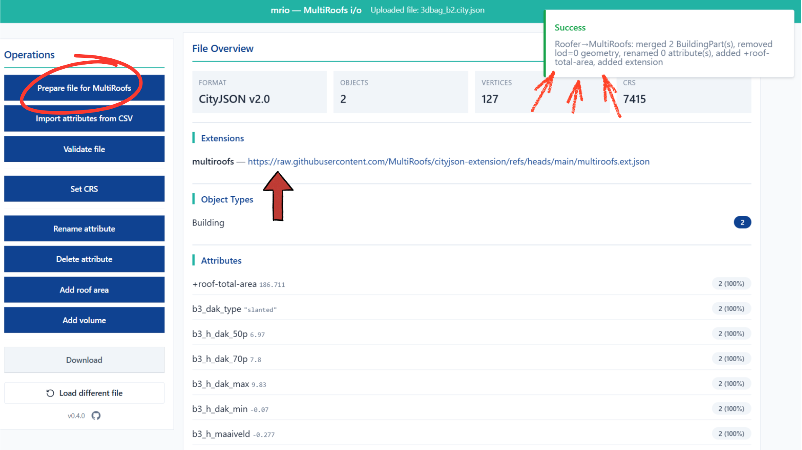
  <p><em>Figure 5: After preparation: BuildingParts merged into their Buildings; Building objects remain.</em></p>
</div>

## 5. Validate file
Validation checks whether the model follows important CityJSON structural rules. Use it before editing and again after any major operation. Green check marks indicate passed checks; red symbols identify findings that need review.


<div style="text-align: center;">
  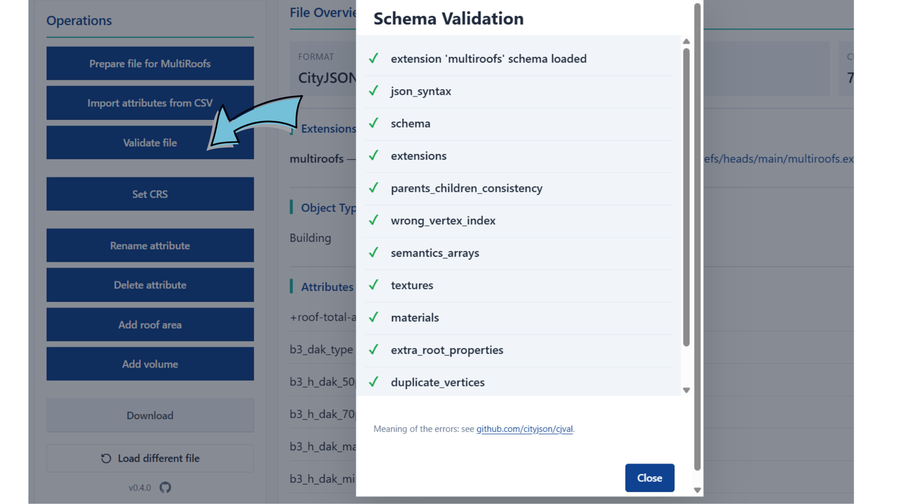
  <p><em>Figure 6: Validation dialog.</em></p>
</div>

## 6. Import attributes from a CSV file (optional)
This operation is optional. You can use it if you have an attribute that you want to add to your file. A CSV is table. Each row represents one CityObject, and its first column must contain that object’s exact ID. The remaining columns become new attributes. The ID column is used for matching, not copied as a new attribute.

The Add Attributes from CSV dialog contains a Choose File, a Cancel button, and an Add attributes button.
If you have a CSV file containing attributes that you want to add to your file, you need to follow these steps:
1. Click Import attributes from CSV.

2. Choose a CSV file with matching CityObject IDs in the first column.

3. Click Add attributes and check the results in the Attributes section.

4. Validate the file after importing.
<div style="text-align: center;">
  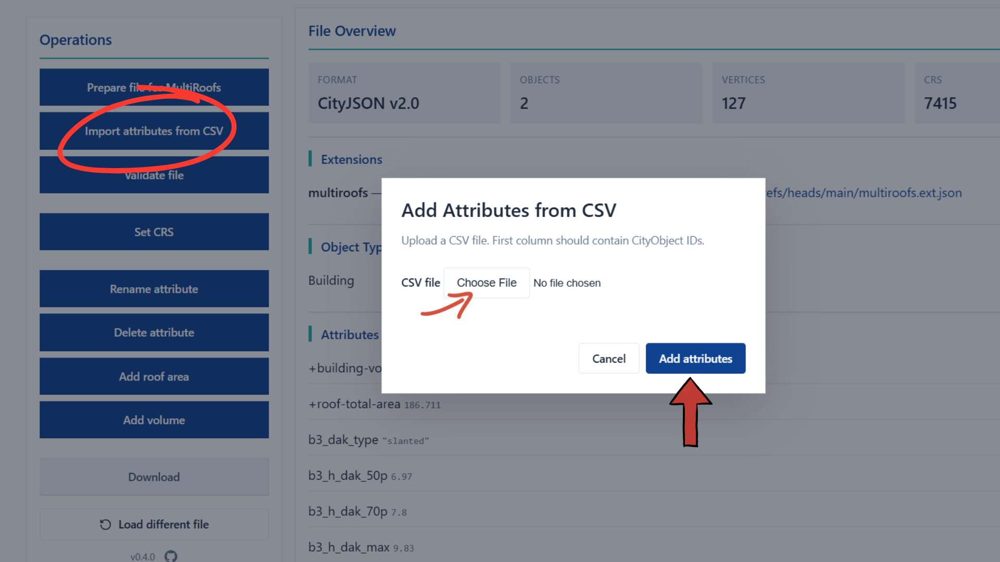
  <p><em>Figure 7: Steps to Add Attributes from a CSV File.</em></p>
</div>

## 8. Rename or delete attributes

### Rename attribute

Click Rename attribute, select the existing attribute name, enter a new name, and click Rename. This changes the attribute key rather than its value. Use meaningful names, and take care with extension-defined attributes such as +roof-total-area.

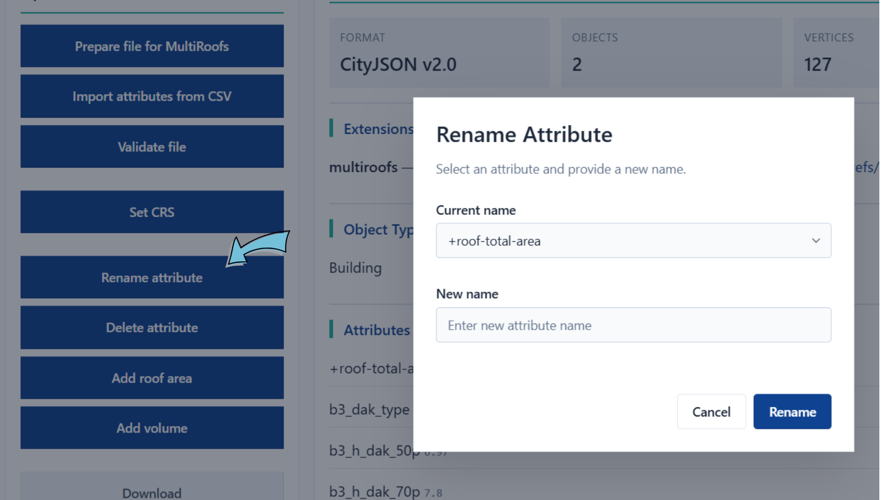

*Figure — Rename Attribute dialog: select an existing name and type its replacement.*

### Delete attribute

Click Delete attribute, choose the attribute to remove, and confirm with Delete. The chosen attribute is removed from the relevant CityObjects, so check carefully before confirming.

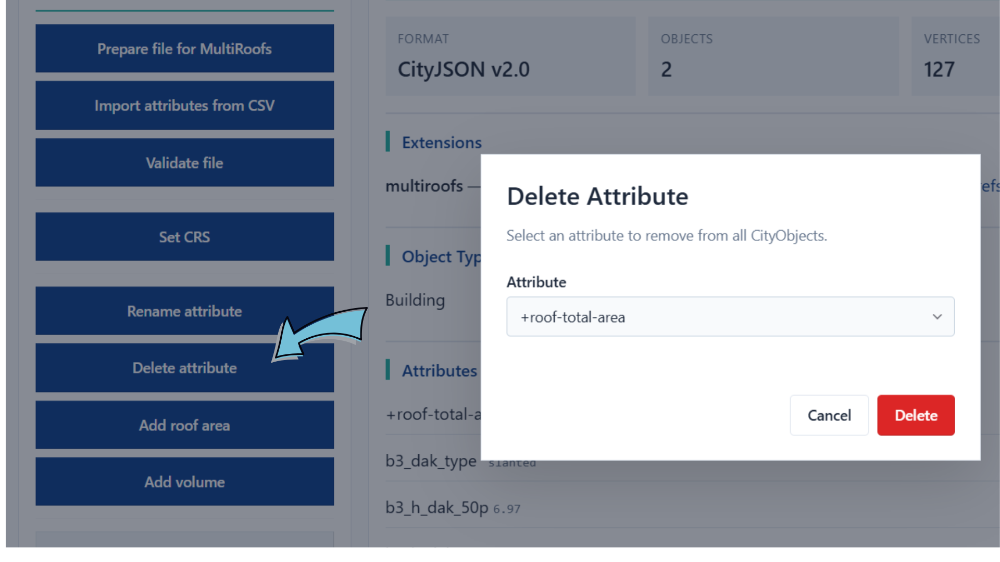

*Figure — Delete Attribute dialog.*

## 9. Add roof area and building volume

Add roof area calculates roof surface information and stores it as an attribute. Add volume calculates building volume information. These values can help with rooftop studies and building analysis.

For Roofer-generated files, a sensible workflow is to first prepare the file for MultiRoofs, then calculate additional properties and run validation. Tests with some original Building/BuildingPart structures showed validation issues when calculations were applied before preparation.

### What does +roof-total-area mean?

As shown in the figure below in the attribute section. The +roof-total-area attribute represents the calculated total area of a building's roof surfaces, rather than the height of the roof. The File Overview displays an example numeric value for this attribute, along with the number and percentage of buildings that contain it. In the illustrated example, the attribute has a displayed value of 186.711, and 2 out of 2 Buildings (100%) contain the +roof-total-area attribute.

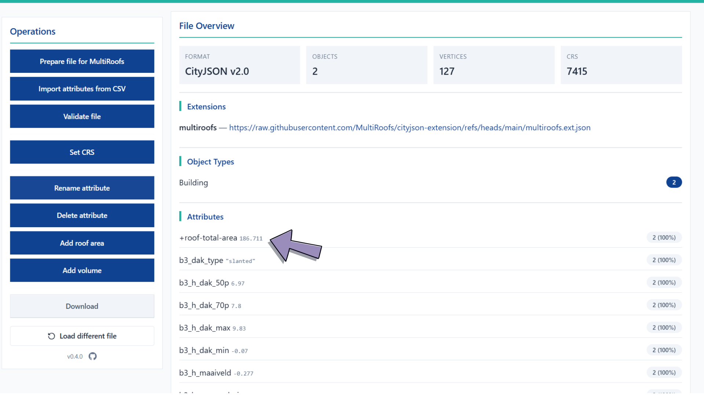

## 7. Set CRS – optional

The Coordinate Reference System (CRS) describes how coordinates relate to locations on Earth. Click Set CRS, enter the intended EPSG code, and confirm. For example, EPSG:28992 is used for the Dutch national coordinate system.

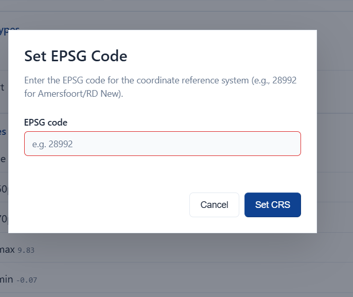

*Figure — Set EPSG Code dialog.*

Caution: this feature changes the CRS identifier in the metadata; it does not reproject the coordinate values. Only set a code that correctly describes the coordinates already in your file.

## 10. Download the result

1. Click Download in the Operations panel.

2. Select CityJSON or CityJSONSeq, depending on the type of your original file.

3. Check the filename and extension: .city.json for CityJSON, .city.jsonl for CityJSONSeq.

4. Click Download, then reopen the saved file in MRIO or another compatible viewer to verify it.

## 11. Recommended workflow for first-time users

2. Upload the file and inspect the File Overview.

3. Run Validate file on the original model.

4. Choose Prepare file for MultiRoofs.

5. If needed, import a CSV or edit attributes; calculate roof area or volume as needed.

6. Validate again and review any findings.

7. Download in the intended format, then reopen the exported file to check it.

</div>

```{toctree}
:maxdepth: 1
```