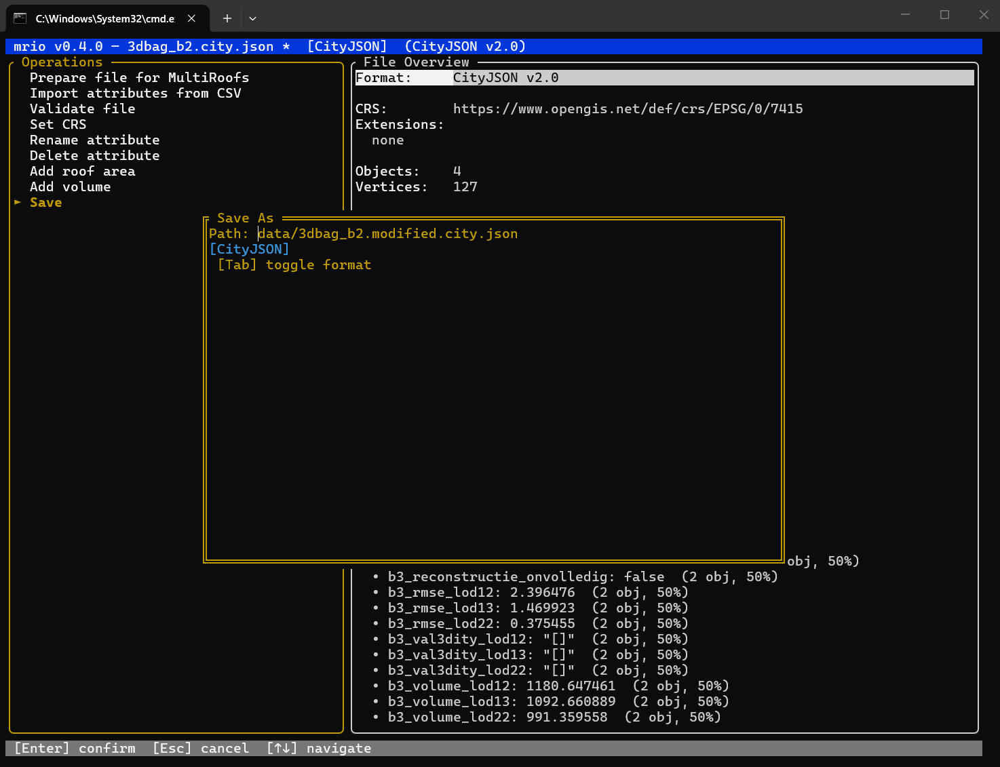

# UI Tutorial

##  Introduction

MRIO (MultiRoofs input/output) is a web tool for preparing, checking, and editing 3D building data. It is part of the MultiRoofs workflow.
MRIO provides a terminal-based user interface (TUI) for inspecting and modifying CityJSON and CityJSONSeq datasets. It runs inside a terminal, most actions are selected from the Operations panel with the keyboard.

This guide explains the complete workflow shown in the supplied screenshots: opening a dataset, navigating the interface, preparing a file for MultiRoofs, importing attributes from CSV, validating a file, renaming and deleting attributes, calculating roof area and building volume, reviewing attributes, and saving the result.

## Installing and Running MRIO on Windows

To work with the MRIO Terminal User Interface (TUI) on Windows, several steps must be completed before the application can be started. MRIO is distributed as source code and is written in Rust, so the source code must first be downloaded and then built on the user's computer. The general workflow consists of downloading the MRIO project from [MRIO GitHub page](https://github.com/MultiRoofs/mrio), installing
Rust and Cargo, this is the official [Rust website](https://rustup.rs/) where you can download Rust, verifying the installation, opening a terminal in the MRIO project directory, building the application, and finally running MRIO with a CityJSON or CityJSONSeq input file.

## 1. Download the MRIO Project

The first step is to obtain the MRIO source code from the project's
GitHub repository. Open the [MRIO repository page](https://github.com/MultiRoofs/mrio) in a web browser and download the project using the **Code → Download ZIP** option.
Alternatively, users who are familiar with Git can clone the repository
directly. 
```{image} images/mrio_githup.png
:width: 700px
:align: center
:alt: MRIO GitHub repository page
```
<p style="text-align: center;"><em>
Figure 1: The MRIO GitHub repository page, where the source code can be downloaded using Code → Download ZIP.</em></p>


When the ZIP archive has finished downloading, extract it to a
convenient location on the computer, for example inside the
Downloads folder. Do not work directly from inside the compressed
ZIP archive. The extracted MRIO directory contains the source code,
example datasets, configuration files, and other files required to build
and run the application.

For example, the extracted directory may be located at:

``` text
C:\Users\<username>\Downloads\mrio
```

A particularly important file in mrio directory is `Cargo.toml`. This
file identifies the Rust project and contains information Cargo needs
when building the application.

## Place the Input Files in the Data Folder
Before starting MRIO, place the input file that you want to process inside the `data` folder of the mrio project. This `data` folder is located inside the mrio project folder that you downloaded from GitHub in the previous step. as shown in Figure 2. This folder provides a convenient location for storing the CityJSON and CityJSONSeq files that will be opened and processed with MRIO.
```{image} images/data_folder.png
:width: 700px
:align: center
:alt: Data folder inside the MRIO project directory
```
<p style="text-align: center;"><em>Figure 2: The data folder inside the main MRIO project directory.</em></p>

## 2. Install Rust

MRIO requires Rust version 1.81 or newer. Download Rust from the official [Rust website](https://rustup.rs/). After downloading the Windows installer, open it. A command-line
installation window will appear and normally display:

``` text
1) Proceed with standard installation (default - just press enter)
2) Customize installation
3) Cancel installation
```
For a normal MRIO installation, choose:

``` text
1) Proceed with standard installation (default - just press enter)
```
Because this is the default option, simply press **Enter**.

```{image} images/rust_download.png
:width: 700px
:align: center
:alt: Rust installation page
```
<p style="text-align: center;"><em>Figure 3: The official Rust installation page for downloading and installing Rust.</em></p>

The standard installation installs **Rust**, **Cargo**, and **rustup**.
Cargo is particularly important for MRIO because it is Rust's package
manager and build system, and MRIO uses commands such as `cargo build`
and `cargo run`.

###  Open a New Terminal After Installing Rust

After installation has completed successfully, close the installation
terminal completely. Then open a new Command Prompt, PowerShell, or
Windows Terminal window. Opening a new terminal is important because the Rust installer modifies the Windows `PATH` environment variable. A terminal that was already
open before installation may not immediately recognize the newly installed commands.

### Verify the Rust and Cargo Installation

In the new terminal, check Rust:

``` bash
rustc --version
```

The displayed Rust compiler version must be 1.81 or newer.

Next, check Cargo:

``` bash
cargo --version
```

For example:

``` text
rustc 1.xx.x
cargo 1.xx.x
```

If both commands return version information, Rust and Cargo are
available and the computer is ready to build MRIO. If Windows reports
that either command is not recognized, make sure installation completed
successfully and that a new terminal was opened afterward.

### Open the MRIO Project Directory in the Terminal

The terminal must be located inside the MRIO project directory before running MRIO Cargo commands.

For example:

``` bash
cd C:\Users\<username>\Downloads\mrio
```

Replace `C:\Users\<username>\Downloads\` with the actual mrio folder location.
Another simple method is to open the extracted MRIO folder in Windows File Explorer, click the address bar, type `cmd`, and press Enter. Command Prompt will open directly in that directory, so you do not need to navigate to the folder manually using the `cd` command.


```{image} images/MRIO_CMD.png
:width: 700px
:align: center
:alt: Opening Command Prompt from the MRIO project folder
```
<p style="text-align: center;"><em>Figure 4: Opening Command Prompt directly from the MRIO project folder using the File Explorer address bar.</em></p>


Verify the directory contents using:

``` bash
dir
```

### Build MRIO and Run with the Example CityJSON File

Figure 5 below explains the build process and provides an example of how to use MRIO.
 Once the terminal is in the MRIO project directory, build the project
using:

``` bash
cargo build --release
```

 During the first build, Cargo may need to download and compile dependencies, so the process can take some time. Compilation messages appearing in the terminal are normal.

Wait until the build finishes. If the command completes without a
compilation error, MRIO has been successfully built and is ready to run.

### Run MRIO with the Example CityJSON File
In this section, the file `data/3dbag_b2.city.json`, which is located in the data folder, is used as an example to demonstrate how to run MRIO. If you want to work with your own CityJSON file instead, first place your file in the data folder and then replace `data/3dbag_b2.city.json` in the command with the name of your file.

For example, the command used in this tutorial is:

``` bash
cargo run -p mrio-cli -- data/3dbag_b2.city.json
```
If your file is named my_buildings.city.json, replace the example filename as follows:

cargo run -p mrio-cli -- data/my_buildings.city.json

If you do not have your own CityJSON file, you can use the example file `3dbag_b2.city.json` provided in the `data` folder. After entering the command, press  `Enter` from the keyboard to start MRIO. If the command runs successfully, the MRIO Terminal User Interface
(TUI) appears directly inside the terminal.


```{image} images/build.png
:width: 700px
:align: center
:alt: Running MRIO with the example CityJSON file
```

<p style="text-align: center;"><em>Figure 5: Running MRIO with the example CityJSON file.</em></p>


## 3. Understanding the MRIO Terminal User Interface

Once MRIO starts, the terminal changes from a normal command prompt into
an interactive interface. The interface is divided primarily into an
<span style="color: darkred;"> **Operations panel**</span> on the left and a <span style="color: darkred;">**File Overview panel**</span> on the
right.
```{image} images/mrio_ui.png
:width: 700px
:align: center
:alt: MRIO Terminal User Interface
```

<p style="text-align: center;"><em>Figure 6: MRIO Terminal User Interface.</em></p>

The <span style="color: #D32F2F; font-weight: 600;">Operations panel</span> , located on the left side of the interface, provides the tools needed to process and modify the uploaded file. Users can calculate roof surface areas and building volumes, delete or rename existing attributes, convert Roofer output into the MultiRoofs format, import additional attributes from CSV files, update the Coordinate Reference System (CRS),  and validate the dataset. The panel also includes a Download button to save the processed file and a Load different file button to upload another dataset.  The workflow is to first prepare the file for MultiRoofs and run validation. 

The <span style="color: #D32F2F; font-weight: 600;">File Overview panel</span> ,  displays information about the loaded dataset, including the CityJSON version, Coordinate Reference System (CRS), extensions, number of objects, number of vertices, object types,
and available attributes. The Object Types section displays the different types of objects contained in the dataset and their quantities. In this example, the file contains 2 Building objects and 2 BuildingPart objects. Buildings represent the main building entities, while BuildingParts represent individual parts of buildings that may contain their 3D geometry. Object Types separates Building and BuildingPart. A BuildingPart can hold the 3D roof/wall geometry while its parent Building holds descriptive information. Attributes are pieces of information attached to objects—for example construction year, roof type, or volume.
### Keyboard controls

MRIO is keyboard-driven. The most important controls are:

| Key | Function |
|---|---|
| `↑` / `↓` | Move through operations or lists |
| `Enter` | Select or confirm the highlighted item |
| `Esc` | Cancel the current dialog |
| `Tab` | Switch to the overview, or toggle the output format in the Save dialog |
| `PgUp` / `PgDn` | Move more quickly through a long overview |
| `s` | Open Save directly from the normal interface |
| `q` | Quit; MRIO can warn about unsaved changes |

## 4. Prepare a file for MultiRoofs workflow

Select Prepare file for MultiRoofs with `↑`/`↓`, then press `Enter`.

```{image} images/mrfigure_03.png
:width: 700px
:align: center
:alt: Preparing a file for MultiRoofs
```

<p style="text-align: center;"><em>Figure 7: File prepared for MultiRoofs.</em></p>

The success message in this example reports that MRIO:

- merged 2 `BuildingPart` objects;
- removed LoD 0 geometry;
- renamed 0 attributes;
- added the `+roof-total-area` attribute; and
- added the MultiRoofs extension.

This operation therefore does more than change the file format. It modifies the loaded dataset so its structure and metadata are prepared for the MultiRoofs workflow.

Press `Enter` to close the success dialog and return to the main interface.

```{image} images/mrfigure_04.png
:width: 700px
:align: center
:alt: File overview after preparation
```

<p style="text-align: center;"><em>Figure 8: File overview after preparation.</em></p>

## 5. Import attributes from a CSV file

Choose Import attributes from CSV and press `Enter`. MRIO opens a text-entry dialog asking for the CSV file path. Type the path to the CSV file and press `Enter`.

```{image} images/mrfigure_05.png
:width: 700px
:align: center
:alt: CSV file path dialog
```

<p style="text-align: center;"><em>Figure 9: CSV file path dialog.</em></p>

For a file inside the project's `data` folder, an example path is:

```text
data/attributes.csv
```

The file must be a real CSV (Comma Separated Values) file. In this example, MRIO reports that attributes were successfully added to 2 objects. A green Success message confirms that the import worked.

```{image} images/mrfigure_08.png
:width: 700px
:align: center
:alt: Successful CSV import
```

<p style="text-align: center;"><em>Figure 10: Successful CSV attribute import.</em></p>


### Matching object identifiers is essential

If you accidentally load the wrong CSV file, or a CSV file containing identifiers that do not match the objects in the loaded CityJSON dataset, the attributes will not be imported. The identifier column in the CSV must refer to CityObject IDs that actually exist in the loaded CityJSON dataset.  If the IDs do not match, MRIO cannot determine which CityObjects should receive the new attribute values. In this case, MRIO may display the message: `Added attributes to 0 object(s) from CSV` means that no object was updated.  Check and correct the IDs in the CSV file so that they match the CityObject IDs in the CityJSON dataset, and then import the corrected CSV file again.

```{image} images/mrfigure_07.png
:width: 700px
:align: center
:alt: CSV object ID error
```
<p style="text-align: center;"><em> Figure 11: CSV import error. The CSV refers to CityObjects `5`, `10`, `11`, and `12`, but those IDs are not present in the loaded dataset</em></p>


## 6. Validate the file
Validation checks whether the model follows important CityJSON structural rules. Use it before editing and again after any major operation. Green check marks indicate passed checks; red symbols identify findings that need review.
Select Validate file and press `Enter` to run MRIO's validation checks.

```{image} images/mrfigure_09.png
:width: 700px
:align: center
:alt: Schema validation results
```

<p style="text-align: center;"><em>Figure 12: CityJSON validation results in MRIO.</em></p>

The dialog can show checks such as JSON syntax, schema, extensions, parent/child consistency, vertex indices, semantics arrays, textures, materials, extra root properties, duplicate vertices, and unused vertices. Treat the validation report as a diagnostic summary investigate any category reported as an error or warning before relying on the dataset downstream.
> **Important:** changes are held in the current MRIO session until you use Save. An asterisk (`*`) beside the filename in the blue title bar indicates that the loaded dataset has unsaved changes.


## 7. Rename an attribute

Choose **Rename attribute** and press `Enter`. MRIO first displays the attributes that can be renamed.

Use `↑`/`↓` to highlight the desired attribute and press `Enter`. MRIO then asks for the new attribute name.

```{image} images/mrfigure_11.png
:width: 700px
:align: center
:alt: Rename attribute selection
```

<p style="text-align: center;"><em>Figure 13: Selecting `+roof-total-area` from the list of attributes to rename.</em></p>

```{image} images/mrfigure_12.png
:width: 700px
:align: center
:alt: New attribute name dialog
```

<p style="text-align: center;"><em>Figure 14: Entering a new name for the selected attribute.</em></p>

Type the new attribute name and press `Enter`. In this example, the attribute `+roof-total-area` is renamed to `top_area`.
```{image} images/mrfigure_13.png
:width: 700px
:align: center
:alt: Entering the new attribute name
```

<p style="text-align: center;"><em>Figure 15: Entering `top_area` as the new attribute name.</em></p>

```{image} images/mrfigure_14.png
:width: 700px
:align: center
:alt: Attribute rename success
```

<p style="text-align: center;"><em>Figure 16: Successful attribute rename.</em></p>

MRIO confirms that the attribute `+roof-total-area` was successfully renamed to `top_area` in 2 objects.

The number of objects in the success message is useful: it tells you how many CityObjects actually contained the renamed attribute.

## 8. Add roof area

Select **Add roof area** and press `Enter`. MRIO calculates the roof area and adds the result as the `+roof-total-area` attribute to applicable objects.

```{image} images/mrfigure_15.png
:width: 700px
:align: center
:alt: Roof area calculation
```

<p style="text-align: center;"><em>Figure 17: Successful roof area calculation.</em></p>

In this example, MRIO confirms that the `+roof-total-area` attribute was successfully added to 2 objects.

After closing the dialog, the new attribute appears in the File Overview. In the supplied example, the overview shows a roof-area value such as `186.711` and indicates the number/percentage of objects carrying the attribute.

## 9. Add building volume

Select Add volume and press `Enter`. MRIO calculates the building volume and adds the `+building-volume` attribute to the applicable objects.

```{image} images/mrfigure_16.png
:width: 700px
:align: center
:alt: Add volume operation
```

<p style="text-align: center;"><em>Figure 18: Add volume operation in MRIO.</em></p>

After the calculation is completed, MRIO displays a success message confirming that the `+building-volume` attribute has been added.

```{image} images/mrfigure_17.png
:width: 700px
:align: center
:alt: Successful volume calculation
```

<p style="text-align: center;"><em>Figure 19: Successful building volume calculation.</em></p>

In this example, MRIO confirms that the `+building-volume` attribute was successfully added to 2 objects. The calculated attribute can then be viewed in the File Overview panel together with the other attributes.

## 10. View all attributes

The normal File Overview may contain more attributes than fit on screen. Press `Tab` to focus the overview panel. The bottom help bar then changes to show overview navigation controls.

Use:

- `↑` / `↓` to scroll line by line;
- `PgUp` / `PgDn` to jump through a long attribute list; and
- `Tab` again to return to the Operations panel.

This is the easiest way to verify newly added, imported, renamed, or calculated attributes before saving.

### Delete an attribute

Select Delete attribute and press `Enter`. MRIO opens a list of the available attributes that can be removed from the dataset.

```{image} images/mrfigure_18.png
:width: 700px
:align: center
:alt: Dataset before deleting an attribute
```

<p style="text-align: center;"><em>Figure 20: File overview before deleting an attribute.</em></p>

Use `↑`/`↓` to choose the attribute that should be removed, then press `Enter`.

```{image} images/mrfigure_19.png
:width: 700px
:align: center
:alt: Remove Attribute dialog
```

<p style="text-align: center;"><em>Figure 21: Selecting an attribute to remove from the dataset.</em></p>

In this example, the attribute `b3_h_dak_50p` is selected for deletion. After confirming the selection, MRIO reports that the attribute was successfully removed from 2 objects.

Deleting an attribute modifies the dataset currently loaded in MRIO. To keep this change, save the modified dataset afterward.

## 11. Save the modified file

Choose Save from the Operations panel, or press `s` from the normal interface.



*Figure 22: Save As dialog. The user can edit the output path and press `Tab` to toggle the output format.*

The Save dialog contains two important settings:

1. **Path** — the destination filename/path, for example `data/3dbag_b2.modified.city.json`.
2. **Output format** — CityJSON or CityJSONSeq.

Press `Tab` to toggle between CityJSON and CityJSONSeq. Make sure the chosen format and filename extension are consistent with the output you intend to create, then press `Enter` to confirm. A green success dialog indicates that the file was written successfully; press `Enter` again to close the message.

## 12. Running MRIO with Your Own File

Users are not limited to the example dataset. One simple approach is to
place another CityJSON file inside the MRIO `data` directory:

``` text
mrio
└── data
    ├── 3dbag_b2.city.json
    └── my_buildings.city.json
```

Then run:

``` bash
cargo run -p mrio-cli -- data/my_buildings.city.json
```

For a CityJSONSeq (`.jsonl`) file:

``` bash
cargo run -p mrio-cli -- data/my_buildings.city.jsonl
```

The filename and path supplied after `--` determine which dataset MRIO
opens.

### Running a Format Conversion

MRIO supports both CityJSON and CityJSONSeq files. When starting MRIO, you can specify the format that should be used when the processed dataset is saved.

For example, the following command opens a CityJSONSeq file and specifies CityJSON as the desired output format:
``` bash
cargo run -p mrio-cli -- data/3dbag_b2.city.jsonl --output-format cityjson
```

This command opens the CityJSONSeq input while specifying CityJSON as
the desired output format.