# UI Tutorial

## 1. Introduction

MRIO provides a terminal-based user interface (TUI) for inspecting and modifying CityJSON and CityJSONSeq datasets. It runs inside a terminal, most actions are selected from the Operations panel with the keyboard.

This guide explains the complete workflow shown in the supplied screenshots: opening a dataset, navigating the interface, preparing a file for MultiRoofs, importing attributes from CSV, validating a file, renaming and deleting attributes, calculating roof area and building volume, reviewing attributes, and saving the result.

## Installing and Running MRIO on Windows

To work with the MRIO Terminal User Interface (TUI) on Windows, several steps must be completed before the application can be started. MRIO is distributed as source code and is written in Rust, so the source code must first be downloaded and then built on the user's computer. The general workflow consists of downloading the MRIO project from [MRIO GitHub page](https://github.com/MultiRoofs/mrio), installing
Rust and Cargo, this is the official [Rust website](https://rustup.rs/) where you can download Rust, verifying the installation, opening a terminal in the MRIO project directory, building the application, and finally running MRIO with a CityJSON or CityJSONSeq input file.

## 1. Download the MRIO Project

The first step is to obtain the MRIO source code from the project's
GitHub repository. Open the [MRIO repository page](https://github.com/MultiRoofs/mrio) in a web browser and download the project using the **Code → Download ZIP** option.
Alternatively, users who are familiar with Git can clone the repository
directly. 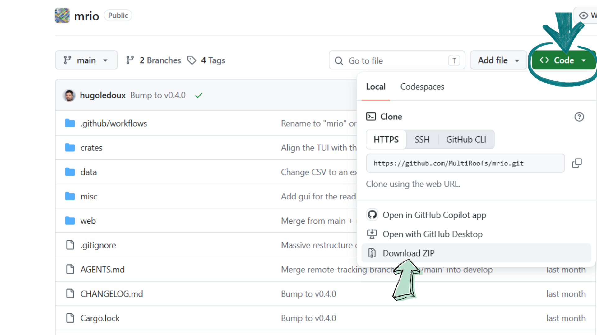

When the ZIP archive has finished downloading, extract it to a
convenient location on the computer, for example inside the
Downloads folder. Do not work directly from inside the compressed
ZIP archive. The extracted MRIO directory contains the source code,
example datasets, configuration files, and other files required to build
and run the application.

For example, the extracted directory may be located at:

``` text
C:\Users\<username>\Downloads\mrio
```

A particularly important file in this directory is `Cargo.toml`. This
file identifies the Rust project and contains information Cargo needs
when building the application. Before executing MRIO build commands,
make sure the terminal is opened in the directory containing
`Cargo.toml`.

## Place the Input Files in the Data Folder
Before starting MRIO, place your input file that you want to process inside the data folder of the MRIO project. The data folder is located in the main MRIO project directory, as shown in Figure 3. This folder provides a convenient location for storing the CityJSON and CityJSONSeq files that will be opened and processed with MRIO.
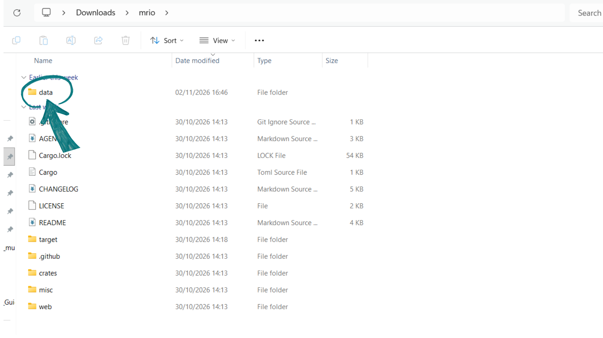
## 2. Install Rust

MRIO requires Rust version 1.81 or newer. Download Rust from the official [Rust website](https://rustup.rs/). After downloading the Windows installer, open it. A command-line
installation window will appear and normally display:

``` text
1) Proceed with standard installation (default - just press enter)
2) Customize installation
3) Cancel installation
```
For a normal MRIO installation, choose:

``` text
1) Proceed with standard installation (default - just press enter)
```
Because this is the default option, simply press **Enter**.

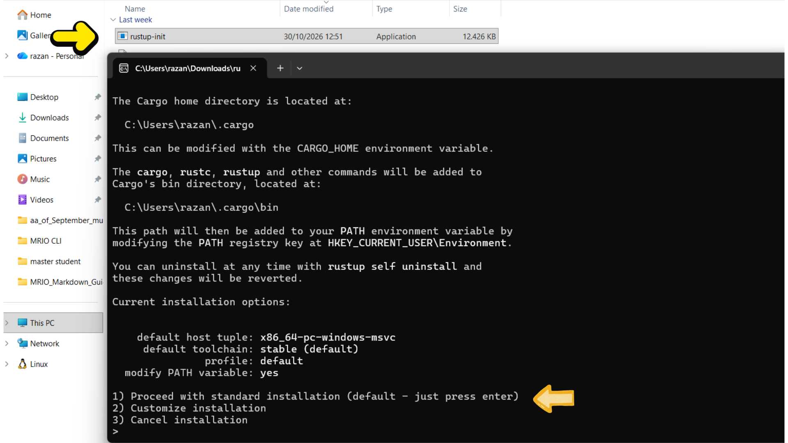


The standard installation installs **Rust**, **Cargo**, and **rustup**.
Cargo is particularly important for MRIO because it is Rust's package
manager and build system, and MRIO uses commands such as `cargo build`
and `cargo run`.

###  Open a New Terminal After Installing Rust

After installation has completed successfully, close the installation
terminal completely. Then open a new Command Prompt, PowerShell, or
Windows Terminal window. Opening a new terminal is important because the Rust installer modifies the Windows `PATH` environment variable. A terminal that was already
open before installation may not immediately recognize the newly installed commands.

### Verify the Rust and Cargo Installation

In the new terminal, check Rust:

``` bash
rustc --version
```

The displayed Rust compiler version must be 1.81 or newer.

Next, check Cargo:

``` bash
cargo --version
```

For example:

``` text
rustc 1.xx.x
cargo 1.xx.x
```

If both commands return version information, Rust and Cargo are
available and the computer is ready to build MRIO. If Windows reports
that either command is not recognized, make sure installation completed
successfully and that a new terminal was opened afterward.

## 2. Open the MRIO Project Directory in the Terminal

The terminal must be located inside the MRIO project directory before running MRIO Cargo commands.

For example:

``` bash
cd C:\Users\<username>\Downloads\mrio
```

Replace `<username>` with the actual Windows username.

Another simple method is to open the extracted MRIO folder in Windows File Explorer, click the address bar, type `cmd`, and press Enter. Command Prompt will open directly in that directory.


Verify the directory contents using:

``` bash
dir
```

### Build MRIO and Run with the Example CityJSON File

Figure 6 below explains the build process and provides an example of how to use MRIO.
 Once the terminal is in the MRIO project directory, build the project
using:

``` bash
cargo build --release
```

 During the first build, Cargo may need to download and compile dependencies, so the process can take some time. Compilation messages appearing in the terminal are normal.

Wait until the build finishes. If the command completes without a
compilation error, MRIO has been successfully built and is ready to run.

### Run MRIO with the Example CityJSON File
In this section, the file `data/3dbag_b2.city.json`, which is located in the data folder, is used as an example to demonstrate how to run MRIO. If you want to work with your own CityJSON file instead, first place your file in the data folder and then replace `data/3dbag_b2.city.json` in the command with the name of your file.

For example, the command used in this tutorial is:

cargo run -p mrio-cli -- data/3dbag_b2.city.json

If your file is named my_buildings.city.json, replace the example filename as follows:

cargo run -p mrio-cli -- data/my_buildings.city.json

If you don't have a file, you can use the file provided in this command. After MRIO has been built successfully, start it from the same project
directory:

``` bash
cargo run -p mrio-cli -- data/3dbag_b2.city.json
```
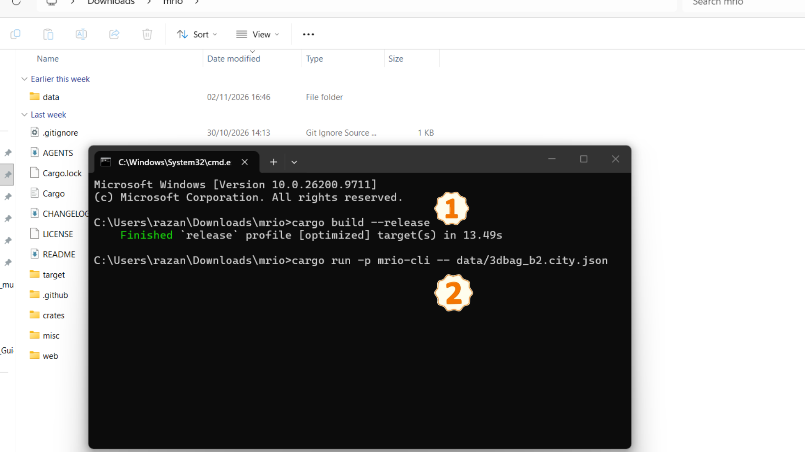
The command consists of `data/3dbag_b2.city.json` specifies the CityJSON file MRIO should
 open.

If the command runs successfully, the MRIO Terminal User Interface
(TUI) appears directly inside the terminal.

## 3. Understanding the MRIO Terminal User Interface

Once MRIO starts, the terminal changes from a normal command prompt into
an interactive interface. The interface is divided primarily into an
<span style="color: darkred;"> **Operations panel**</span> on the left and a <span style="color: darkred;">**File Overview panel**</span> on the
right.
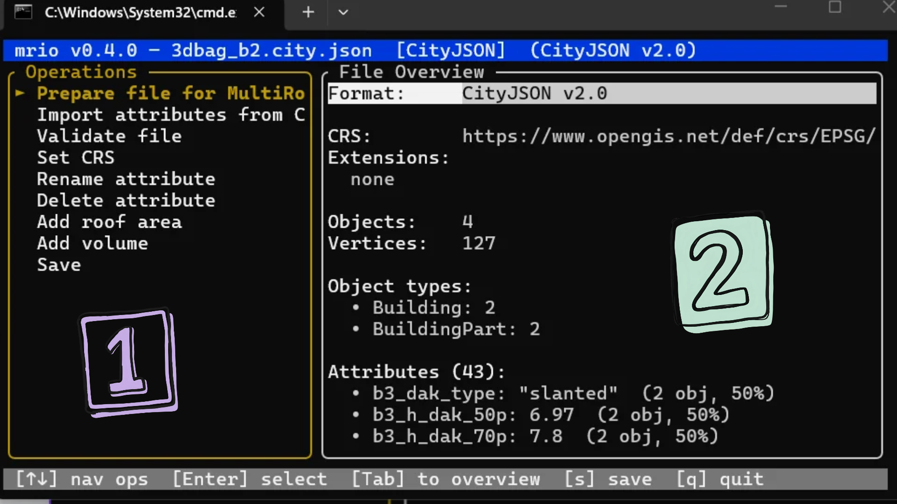

The Operations panel can include:
-   Prepare file for MultiRoofs
-   Import attributes from CSV
-   Validate file
-   Set CRS
-   Rename attribute
-   Delete attribute
-   Add roof area
-   Add volume
-   Save

The File Overview panel displays information about the loaded dataset, including the CityJSON version, Coordinate Reference System (CRS), extensions, number of objects, number of vertices, object types,
and available attributes.

### Keyboard controls

MRIO is keyboard-driven. The most important controls are:

| Key | Function |
|---|---|
| `↑` / `↓` | Move through operations or lists |
| `Enter` | Select or confirm the highlighted item |
| `Esc` | Cancel the current dialog |
| `Tab` | Switch to the overview, or toggle the output format in the Save dialog |
| `PgUp` / `PgDn` | Move more quickly through a long overview |
| `s` | Open Save directly from the normal interface |
| `q` | Quit; MRIO can warn about unsaved changes |

## 4. Prepare a file for MultiRoofs

Select Prepare file for MultiRoofs with `↑`/`↓`, then press `Enter`.

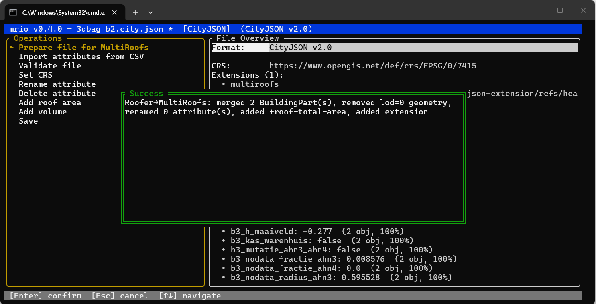

*Figure 3: Successful preparation of the CityJSON dataset for MultiRoofs.*

The success message in this example reports that MRIO:

- merged 2 `BuildingPart` objects;
- removed LoD 0 geometry;
- renamed 0 attributes;
- added the `+roof-total-area` attribute; and
- added the MultiRoofs extension.

This operation therefore does more than change the file format. It modifies the loaded dataset so its structure and metadata are prepared for the MultiRoofs workflow.

Press `Enter` to close the success dialog and return to the main interface.

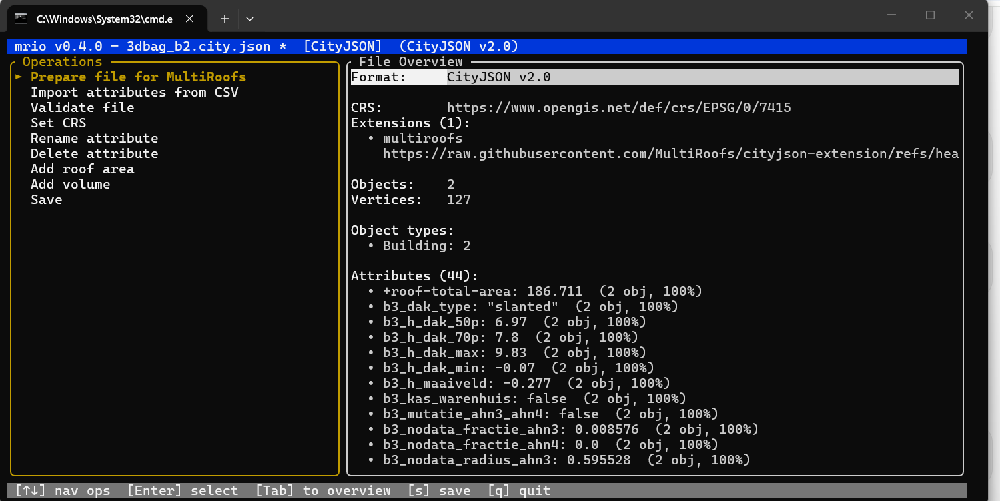

*Figure 4: File overview after preparation. The dataset now contains the MultiRoofs extension and the prepared building information.*

## 5. Import attributes from a CSV file

Choose Import attributes from CSV and press `Enter`. MRIO opens a text-entry dialog asking for the CSV file path.

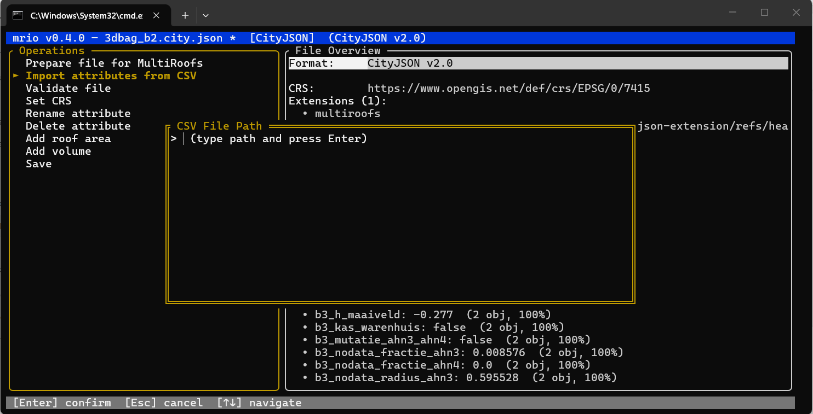

*Figure 5: CSV File Path dialog. Type the path to the CSV file and press `Enter`.*

For a file inside the project's `data` folder, an example path is:

```text
data/attributes.csv
```

The file must be a real CSV (Comma Separated Values) file. An Excel `.xlsx` workbook is not the same format.
The message `Added attributes to 0 object(s) from CSV` means that no object was updated. Correct the CSV IDs so they match the CityObject IDs in the CityJSON file, then import the corrected CSV again.

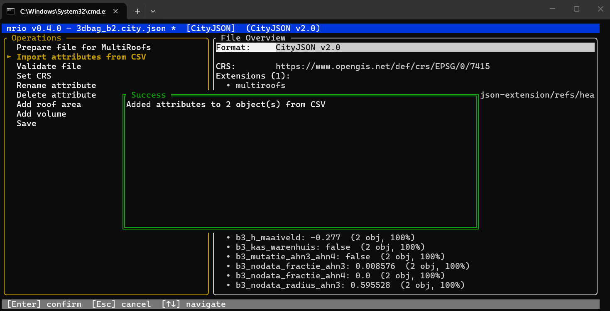

*Figure 8: Successful CSV import. MRIO reports that attributes were added to 2 objects.*

A green Success message confirms that the import worked.


### Matching object identifiers is essential

The identifier column in the CSV must refer to CityObject IDs that actually exist in the loaded CityJSON dataset. If they do not match, MRIO cannot decide which objects should receive the new values.

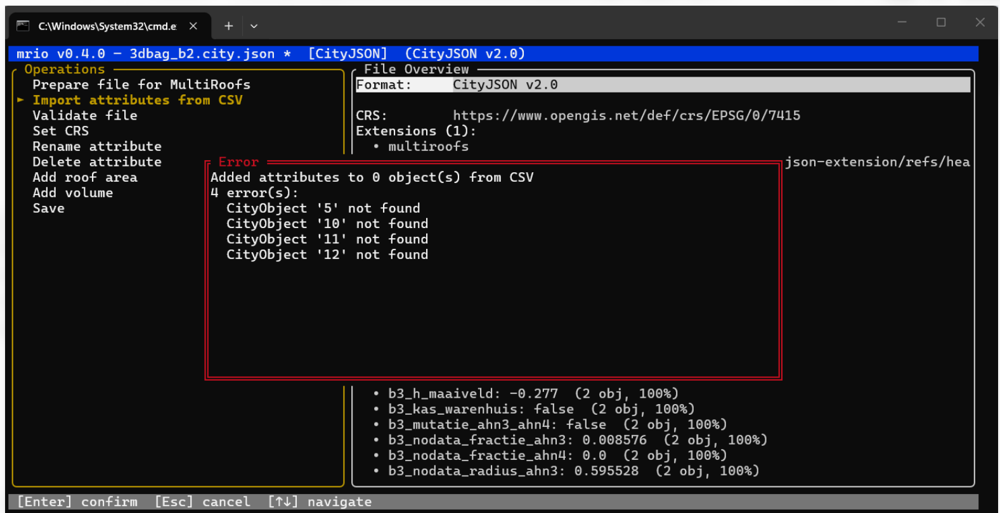

*Figure 7: CSV import error. The CSV refers to CityObjects `5`, `10`, `11`, and `12`, but those IDs are not present in the loaded dataset.*


## 6. Validate the file

Select Validate file and press `Enter` to run MRIO's validation checks.

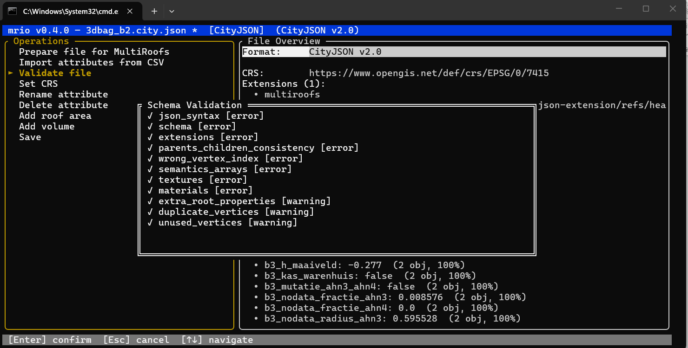

*Figure 9: Schema Validation results showing the validation categories checked by MRIO.*

The dialog can show checks such as JSON syntax, schema, extensions, parent/child consistency, vertex indices, semantics arrays, textures, materials, extra root properties, duplicate vertices, and unused vertices. Treat the validation report as a diagnostic summary investigate any category reported as an error or warning before relying on the dataset downstream.
> **Important:** changes are held in the current MRIO session until you use Save. An asterisk (`*`) beside the filename in the blue title bar indicates that the loaded dataset has unsaved changes.


## 7. Rename an attribute

Choose **Rename attribute** and press `Enter`. MRIO first displays the attributes that can be renamed.

Use `↑`/`↓` to highlight the desired attribute and press `Enter`.

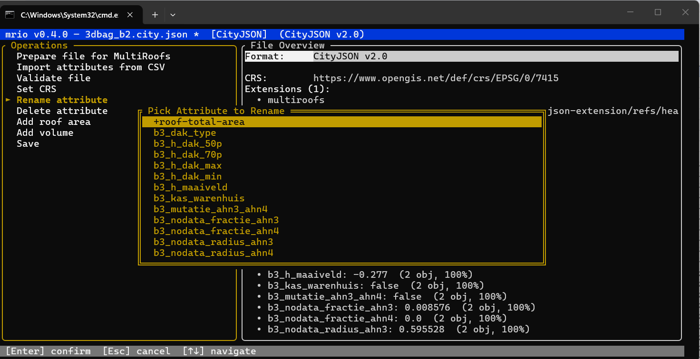

*Figure 11: Selecting `+roof-total-area` from the list of attributes to rename.*

MRIO then asks for the new attribute name.

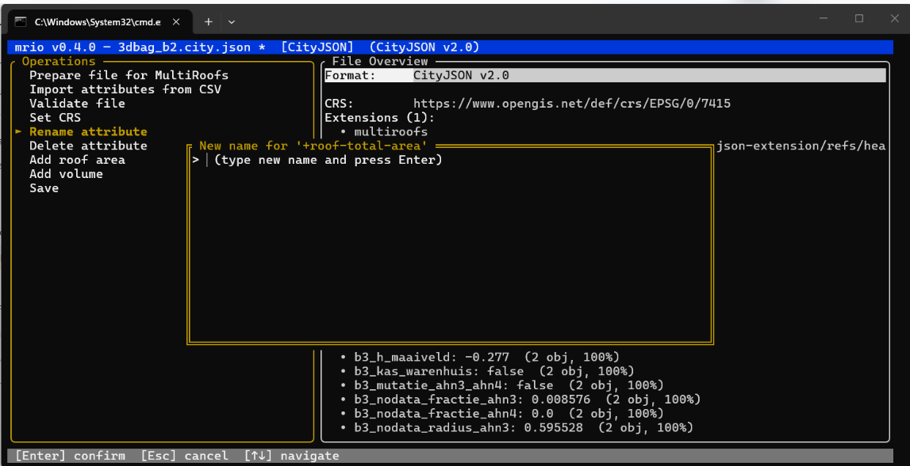

*Figure 12: Dialog requesting a new name for the selected attribute.*

Type the new name and press `Enter`. In the example, `+roof-total-area` is renamed to `top_area`.

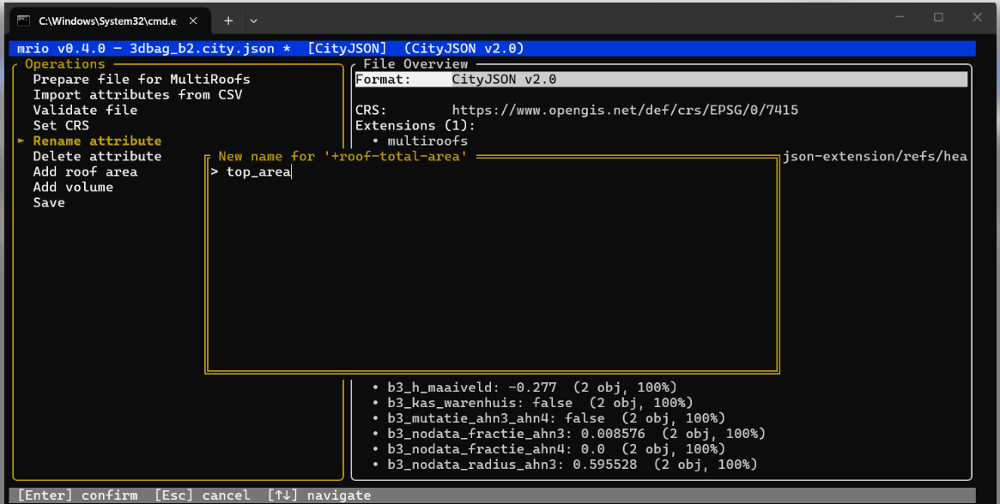

*Figure 13: Entering `top_area` as the replacement attribute name.*

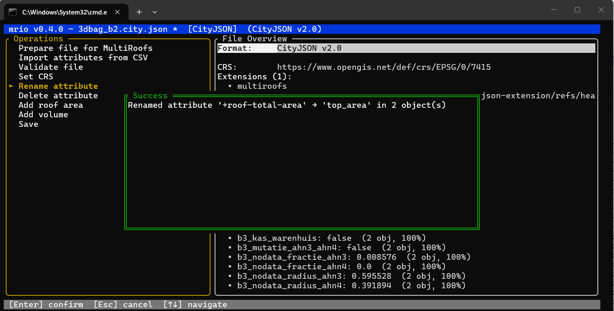

*Figure 14: Successful rename. MRIO reports that `+roof-total-area` was renamed to `top_area` in 2 objects.*

The number of objects in the success message is useful: it tells you how many CityObjects actually contained the renamed attribute.

## 8. Add roof area

Select **Add roof area** and press `Enter`. MRIO calculates the roof area and adds the result as the `+roof-total-area` attribute to applicable objects.

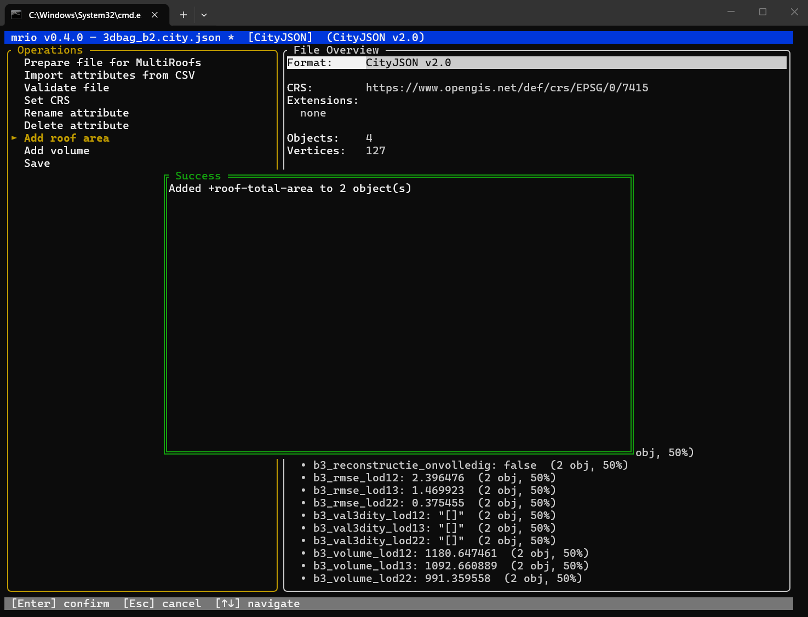

*Figure 15: Successful roof-area calculation. MRIO reports that `+roof-total-area` was added to 2 objects.*

After closing the dialog, the new attribute appears in the File Overview. In the supplied example, the overview shows a roof-area value such as `186.711` and indicates the number/percentage of objects carrying the attribute.

## 9. Add building volume

Select **Add volume** and press `Enter`. MRIO calculates building volume and adds the `+building-volume` attribute to applicable objects.

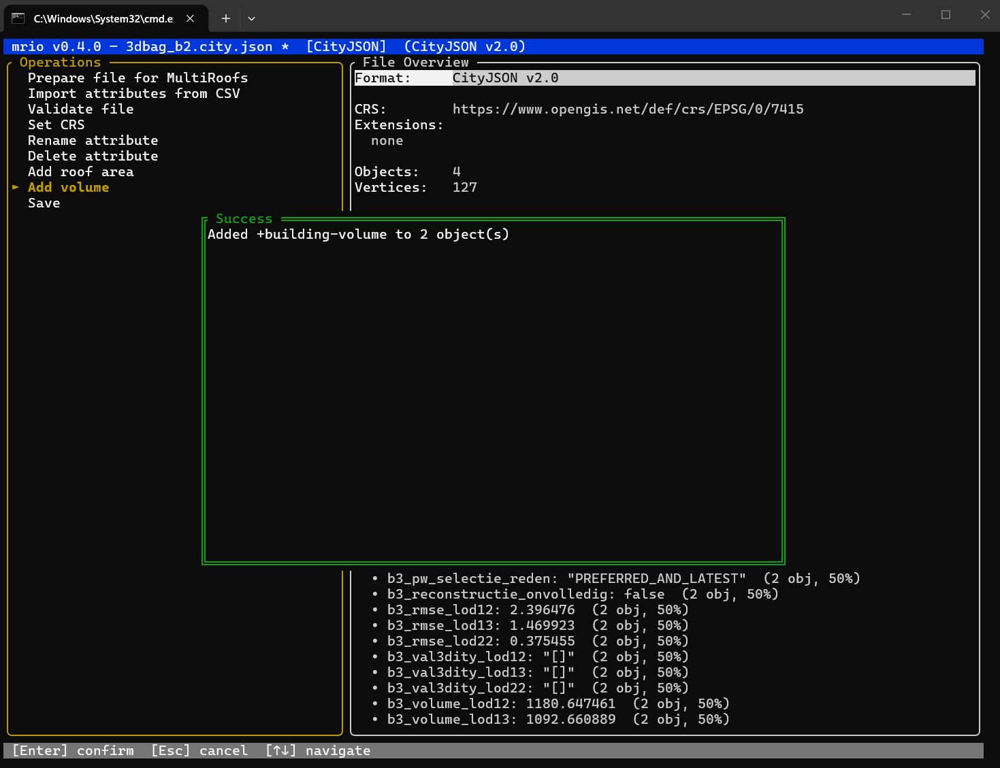

*Figure 16: Add volume operation in the MRIO interface.*

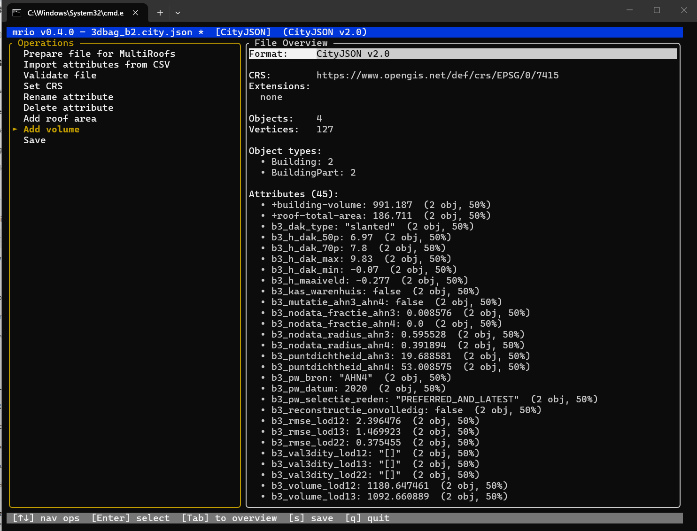

*Figure 17: Successful volume calculation. MRIO reports that `+building-volume` was added to 2 objects.*

The calculated attribute can then be inspected in the overview together with the other attributes.

## 10. View all attributes

The normal File Overview may contain more attributes than fit on screen. Press `Tab` to focus the overview panel. The bottom help bar then changes to show overview navigation controls.

Use:

- `↑` / `↓` to scroll line by line;
- `PgUp` / `PgDn` to jump through a long attribute list; and
- `Tab` again to return to the Operations panel.

This is the easiest way to verify newly added, imported, renamed, or calculated attributes before saving.

### Delete an attribute

Select **Delete attribute** and press `Enter`. MRIO opens a list of available attributes.

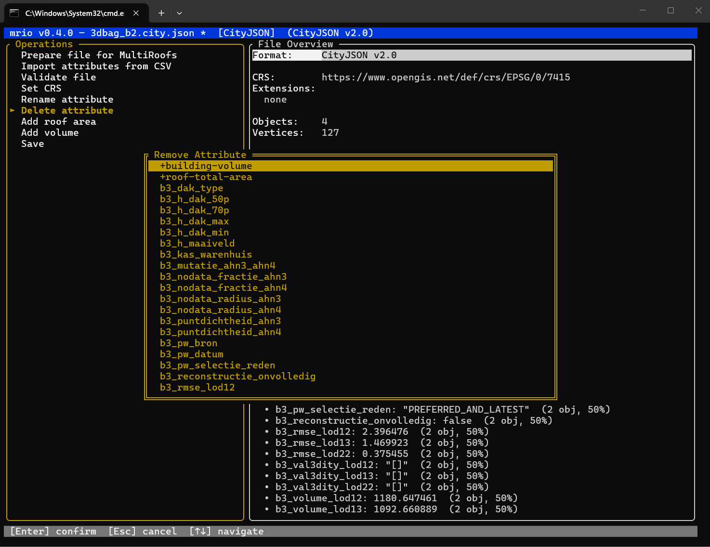

*Figure 18: File overview before deleting an attribute.*

Use `↑`/`↓` to choose the attribute that should be removed, then press `Enter`.

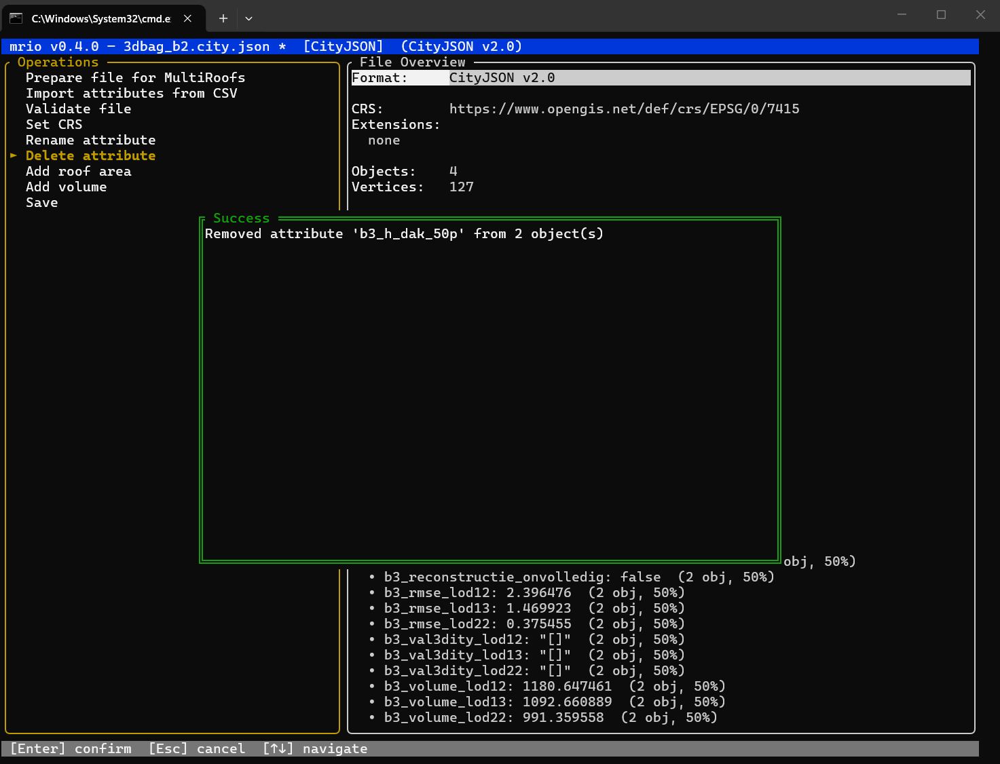

*Figure 19: Remove Attribute dialog. The user selects the attribute to delete from the dataset.*

In the tested workflow, `b3_h_dak_50p` was selected. MRIO subsequently reported that the attribute was removed from 2 objects. Deleting an attribute changes the in-memory dataset, so save the file afterward if the deletion should be kept.

## 11. Save the modified file

Choose **Save** from the Operations panel, or press `s` from the normal interface.


*Figure 20: Save As dialog. The user can edit the output path and press `Tab` to toggle the output format.*

The Save dialog contains two important settings:

1. **Path** — the destination filename/path, for example `data/3dbag_b2.modified.city.json`.
2. **Output format** — CityJSON or CityJSONSeq.

Press `Tab` to toggle between **CityJSON** and **CityJSONSeq**. Make sure the chosen format and filename extension are consistent with the output you intend to create, then press `Enter` to confirm. A green success dialog indicates that the file was written successfully; press `Enter` again to close the message.

## 12. Running MRIO with Your Own File

Users are not limited to the example dataset. One simple approach is to
place another CityJSON file inside the MRIO `data` directory:

``` text
mrio
└── data
    ├── 3dbag_b2.city.json
    └── my_buildings.city.json
```

Then run:

``` bash
cargo run -p mrio-cli -- data/my_buildings.city.json
```

For a CityJSONSeq (`.jsonl`) file:

``` bash
cargo run -p mrio-cli -- data/my_buildings.city.jsonl
```

The filename and path supplied after `--` determine which dataset MRIO
opens.

### Running a Format Conversion

MRIO can also be started with an output-format option. For example:

``` bash
cargo run -p mrio-cli -- data/3dbag_b2.city.jsonl --output-format cityjson
```

This command opens the CityJSONSeq input while specifying CityJSON as
the desired output format.